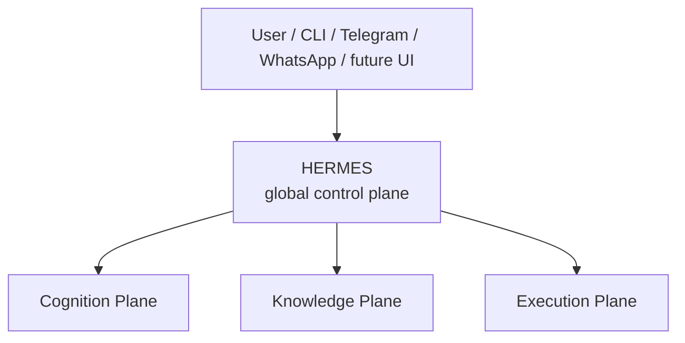
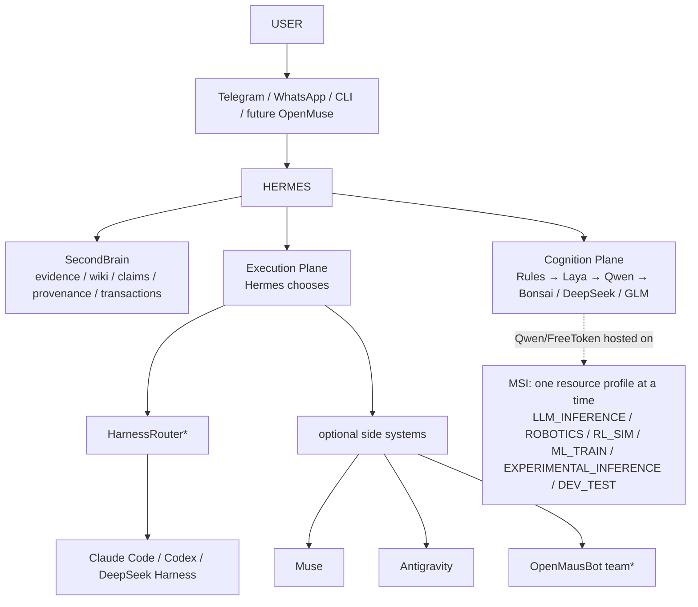

# Agent OS — Current Architecture

**Status:** current canonical reference. **Last reconciled:** 2026-09-24.

This document is the detailed architecture reference for the Agent OS. It
does not propose a redesign — it captures the architecture decisions already
made over the past weeks into one coherent place, and marks what is real,
what is candidate, and what is still just an idea.

`README.md` stays short and points here. This file is where the depth lives.

### Status legend (used throughout this document)

| Label | Meaning |
|---|---|
| **CURRENT / CORE** | Running today, load-bearing. |
| **BENCHMARK CANDIDATE** | Named, scoped, not yet validated against acceptance criteria. |
| **OPTIONAL** | Useful if adopted, never a required dependency. |
| **LAB** | Experimental/exploratory only, not a routing target. |
| **FUTURE** | Real intent, no current build, not a dependency of anything today. |

No entry in this document is marked CURRENT/CORE or validated unless repo
evidence (`config/`, `audit/`) or explicit live confirmation backs it.
Everything else keeps its honest, weaker status.

### Autonomous runtime behavior

How the planes below actually behave during a long-running or autonomous
task — loop termination, progress detection, evaluator independence, graph
composition — is governed by
**[`docs/loop-graph-engineering.md`](loop-graph-engineering.md)**. That
document does not change anything below; it describes the runtime discipline
this architecture is expected to follow.

---

## 1. Core Identity

**Hermes** = WHO runs and orchestrates the system.
**`~/agent-stack`** = HOW the system operates.
**`~/SecondBrain`** = WHAT the system knows.

Hermes is the single global semantic orchestrator / control plane.

No model, harness, research framework, OpenMausBot, HarnessRouter, Prime,
AutoResearch, or any other component becomes a second global orchestrator.
This is an invariant, not a preference — see §19 for the explicit
anti-duplication rules this implies.

---

## 2. Top-Level Architecture



Hermes' responsibilities:

- policy enforcement
- permissions
- task lifecycle
- context assembly
- routing
- worker selection
- scheduling
- approvals
- retries
- checkpoints
- resource arbitration
- cost/latency policy
- telemetry collection
- memory admission

Everything else in this document sits under one of the three planes above,
or is an optional side-system that talks to Hermes rather than replacing it.

---

## 3. Knowledge Plane — SecondBrain

**Status: CURRENT / CORE** (layout and rules — retrieval sophistication is
lower down the stack, see below).

Current canonical durable knowledge store:

```
~/SecondBrain/
├── inbox/
├── .raw/
├── wiki/
│   ├── sources/
│   ├── meta/ledgers/
│   ├── projects/
│   ├── research/
│   ├── concepts/
│   ├── entities/
│   ├── decisions/
│   ├── index.md
│   ├── hot.md
│   ├── log.md
│   └── overview.md
├── .vault-meta/
├── .obsidian/
└── .claude-obsidian.json
```

- **`inbox/`** = candidate inputs.
- **`.raw/`** = immutable/content-addressed evidence.
- **`wiki/`** = compiled durable knowledge.
- **source ledger** (`wiki/meta/ledgers/`) = source identity/provenance.
- **claim ledger** (`wiki/meta/ledgers/`) = evidence-backed belief/claim state.
- **`.vault-meta/`** = transaction/runtime/recovery state.

Existing stack: Obsidian, `claude-obsidian`, Kepano `obsidian-skills`.

### Canonical write rule

```
worker result
  → Hermes
  → durable?
  → provenance/evidence
  → review/judge/transaction
  → canonical SecondBrain
```

Workers do NOT silently overwrite canonical `wiki/`. This is enforced in
`config/permissions.yaml` — only the `reviewer` role can write `wiki/`, and
that write is still gated by `protected.canonical_knowledge.requires_review`.

### What this architecture explicitly does NOT require

- PostgreSQL
- Redis
- Qdrant
- Graphiti
- a generic vector DB
- a mandatory knowledge graph

These are **future, capability-gap-driven options only** — not V1
dependencies. Nothing in the current stack needs them to function.

### Retrieval evolution path (if/when justified)

```
grounded current retrieval
  → lexical/BM25
  → reranking/embeddings
  → temporal graph (only if justified)
```

Do not reintroduce these technologies as V1 dependencies. Each step is
adopted only after the step before it demonstrates a real capability gap.

---

## 4. agent-stack Responsibility

This repository's intended directory layout (several of these are scaffolded
empty directories today — see the note after the list):

| Directory | Responsibility |
|---|---|
| `config/` | declarative system policy/config |
| `agents/` | agent/worker role contracts |
| `adapters/` | external-system/runtime bridges |
| `skills/` | curated procedural capabilities |
| `workflows/` | reusable operational flows |
| `evals/` | acceptance/regression/quality evaluation |
| `state/` | operational runtime state, NOT durable knowledge |
| `audit/` | historical tests/snapshots/evidence |
| `scripts/` | validation/maintenance utilities |
| `docs/` | architecture/decision reference (this file) |

**Current repo evidence (2026-09-24):** `config/`, `audit/`, and `docs/`
contain real content. `agents/`, `adapters/`, `skills/`, `workflows/`,
`evals/`, `state/`, and `scripts/` exist on disk as empty scaffolded
directories (created 2026-09-15) with no content yet and nothing tracked in
git. That is the honest current state — not a gap to hide, not something to
fill speculatively in this pass.

`agent-stack` is **not** a knowledge dump and **not** a replacement for
SecondBrain. Anything durable that agent-stack work produces (a lesson, a
decision record) still flows through the canonical write rule in §3, not
directly into this repo's own history as "knowledge."

---

## 5. Hardware Plane — Current Real Hardware

### Mac mini

Current:

- Apple M4
- 16 GB unified memory
- 256 GB SSD

Primary role: **always-on control plane**.

Intended services: Hermes, SecondBrain, agent-stack, claude-obsidian,
gateway/scheduler, light operational services.

Candidate services (not running today): Laya-MLX, HarnessRouter, Bonsai 2
on demand.

Do not treat the Mac as the primary giant-model inference machine.

### MSI

Current:

- RTX 4070 Laptop, 8 GB VRAM
- 32 GB RAM
- Ubuntu

It is a **switchable compute node**, not a dedicated LLM server. One
resource profile runs at a time; profiles are mutually exclusive on the GPU.

| Profile | Workload |
|---|---|
| `LLM_INFERENCE` | FreeToken + Qwen3.6 |
| `ROBOTICS` | ROS2 / Gazebo |
| `RL_SIM` | MuJoCo |
| `ML_TRAIN` | PyTorch / CUDA |
| `EXPERIMENTAL_INFERENCE` | WARP or Colibri, one at a time |
| `DEV_TEST` | generic engineering workloads |

### GPU conflict lifecycle

```
new GPU-heavy task
  → drain Qwen requests
  → unload Qwen/FreeToken
  → fall back to Bonsai/cloud reasoning
  → execute GPU workload
  → finish
  → restore Qwen
  → health check
```

This lifecycle is what makes the MSI usable as both a reasoning host and a
GPU workload host without the two silently corrupting each other — an
in-flight Qwen request never shares the GPU with a robotics/ML job.

### Future RTX 3080 node

**Status: FUTURE.** Hardware exists/planned. It is **not** a current
architecture dependency. Do not build current workflows that require it.

---

## 6. Cognition Plane

Cognition is not a simple "intelligence ladder" — it is an operational
pipeline where each stage exists to avoid invoking the next one unless
necessary:

```
deterministic rules
      ↓
FastGate
      ↓
normal local reasoning
      ↓
frontier escalation when needed
```

### C0 — Deterministic rules

No model when deterministic logic suffices: exit code handling, known cron
events, GPU availability, deadlines, explicit test failures, static
permissions, simple resource decisions.

### C1 — FastGate abstraction

```
FastGate
├── Laya-MLX        current benchmark candidate
└── Jev-style gate  future alternative/experiment
```

Laya is **not** a generative brain. Intended tasks: task classification,
worker-class selection, tool-class selection, risk classification, urgency,
notification importance, `needs_memory`, `needs_gpu`, background vs.
immediate, escalation recommendation, MSI resource profile, retrieval scope
selection.

Intended first checkpoint: multilingual Laya, ~322M params, Mac mini.

**Status: BENCHMARK CANDIDATE — NOT a validated production component yet.**

Laya works only on compact operational state; do not send large SecondBrain
contexts into it.

Confidence is advisory, not authoritative:

- high confidence + low risk → a direct policy route may be allowed
- uncertain → escalate to Qwen reasoning
- high risk → stronger model and/or human approval **regardless** of Laya's
  confidence

### C2 — Default local reasoning

Candidate: **Qwen3.6-35B-A3B**, runtime **FreeToken**, host **MSI**.

Role: normal planning, tool sequencing, routine reasoning, worker-selection
verification, task decomposition, operational loops, summarization.

**Status: primary local reasoning candidate — benchmark/deployment
pending.** `llama.cpp` may remain the fallback runtime if FreeToken does not
satisfy stability/performance requirements.

### C3 — Mac local resilience

Candidate: **Bonsai 2 (27B)**, host Mac mini, on-demand residency.

Role: MSI unavailable/busy, local fallback, short reasoning, local
synthesis, notification/report drafting, degraded/offline operation.

This is an **operational role, not an IQ rank** — it is not "worse
intelligence," it is "the thing that answers when the MSI can't."

**Qwen3.8** — optional benchmark/local-judge candidate. **Status: OPTIONAL,
not a required V1 tier.**

### C4 — Frontier reasoning

Preferred concept: **DeepSeek direct API** for interactive
difficult-reasoning escalation. Challenger/alternative: **GLM**.

**NVIDIA NIM + DeepSeek V4.1 Flash (via DeepSeek Harness):**

- validated model/harness combination (`audit/nvidia-nim-2026-09-24.md`)
- variable/slow provider latency
- background specialist
- **NOT** an interactive primary backend

Historical NIM benchmark evidence (`moonshotai/kimi-k3` unreliable —
`audit/nvidia-nim-2026-09-23.md`) is preserved, not deleted, and remains
true: it is a different model on the same provider, and its finding stands
unchanged by the DeepSeek result.

---

## 7. Giant Local Inference

Kept explicitly separate from the normal Hermes control loop — these are not
routing targets today:

- **WARP** — LAB
- **Colibri** — LAB
- **MoE-Infinity** — LAB (third experimental option)
- **Kimi K3** — impractical on current hardware (local giant-inference
  sense; distinct from the NVIDIA NIM API reliability finding in §6/§18,
  which is about a hosted endpoint, not local hardware)
- **Splash** — current Mac RAM insufficient

Intended use: experimental, privacy/offline frontier testing,
overnight/background reasoning, runtime research. **Do not make them
required production routing backends.**

---

## 8. Execution Plane

**Models = cognition. Harnesses = execution.** Harnesses are not simply
"higher reasoning levels" — they are how a chosen model actually gets to do
work (files, shell, tool calls, sessions).

### Core execution workers — CURRENT / CORE

- **Claude Code** — architecture, difficult debugging, hard refactoring,
  critical code review.
- **Codex** — autonomous implementation, multi-file changes, tests, routine
  debugging.

### Additional specialists

- **Muse** — parallel/batch coding throughput.
- **Antigravity** — Google/browser/editor/multimodal workflows.

### Optional

- **Prime**
- **OpenCode**

Not core dependencies yet.

---

## 9. HarnessRouter

**Status: high-priority BENCHMARK CANDIDATE — NOT canonical production
transport yet.**

Role: execution transport / harness lifecycle normalization.

- **Hermes decides:** WHAT should happen, WHO should do it.
- **HarnessRouter handles:** HOW the selected harness is invoked — session
  start, continuation, streaming, artifacts/files, cancellation, structured
  failure.

Current promising native bases include Claude Code, Codex, DeepSeek
Harness, OpenCode, Gemini CLI, Qwen Code, and others. Muse and Antigravity
currently remain side/direct adapters unless native support is independently
verified later.

**Prevent recursion:** `global Hermes → HarnessRouter → Hermes` must **not**
be the normal dispatch path — HarnessRouter is a transport layer under
Hermes, not a loop back into orchestration.

### Benchmark before KEEP

- Hermes-owned Git worktree compatibility
- session continuity
- artifact handling
- cancellation
- restart recovery
- Mac RAM/disk overhead
- secrets/isolation
- error behavior

---

## 10. OpenMausBot — Optional Persistent Team / Coworker Subsystem

OpenMausBot is **not** another global orchestrator.

It is an open-source Grok-Bot-style persistent team environment where bots
can have identity/personality, persistent threads, channels, routines, a
model/engine, a computer, connected apps, approvals, and voice.

### Potential Hermes integration

```
Hermes
   │
   │ bounded MCP
   ▼
OpenMausBot
   │
   ├── Career Scout
   ├── Research Scout
   ├── Side-Project Ops
   ├── Admin/Inbox Bot
   └── Monitoring Bot
```

**Best use cases:** persistent autonomous coworkers, monitoring, recurring
ops, career/job scouting, research scanning, inbox/admin work, side-project
operations, long-lived channels/routines.

**NOT preferred for:** core coding execution transport, canonical routing,
canonical memory, global policy.

**Important:** OpenMausBot's harness layer overlaps substantially with
HarnessRouter (§9). Do **not** stack both lifecycle layers unnecessarily.

**Current architecture position:** OpenMausBot = optional team subsystem /
HarnessRouter challenger. A future benchmark may directly compare
HarnessRouter vs. OpenMausBot's MCP/harness layer.

Existing Claude/Codex CLI subscriptions/logins may be reused by OpenMausBot;
API keys/cloud computers/connectors are optional depending on which features
are enabled.

Canonical SecondBrain remains outside OpenMausBot. Any durable result still
follows: `OpenMausBot → Hermes → memory admission → SecondBrain`.

**Status: OPTIONAL.**

---

## 11. OpenMuse — Optional Rich Human Interface

OpenMuse is **not** Meta Muse Code and is **not** a coding-worker
replacement.

It is a CopilotKit/AG-UI personal-agent application with mobile/web chat,
task/activity UI, approvals, browser takeover, files/PDF artifacts,
goals/tracking, Gmail/Calendar, a browser worker, and an optional Linux
computer.

Potential role: future Hermes mobile/web control surface.

- **Telegram/WhatsApp** remain lightweight command + notification channels.
- **OpenMuse** would add richer monitoring, task/activity views, approvals,
  artifact browsing, browser takeover, progress tracking.

```
Telegram / WhatsApp   = ambient/lightweight control
OpenMuse               = optional rich dashboard/control surface
Hermes                 = actual brain/orchestrator
```

**Status: reference/watch candidate — NOT a V1 dependency.**

Note: OpenMuse's current architecture requires a CopilotKit Intelligence
project key even in its present modes — it is not a zero-dependency
pure-local UI shell today.

If evaluated later, prefer `OpenMuse UI → AG-UI or adapter → Hermes` rather
than letting OpenMuse become a competing canonical memory/control plane.

---

## 12. Coding Safety / Worktree Flow

```
request
  → project context
  → spec
  → routing
  → isolated Git worktree
  → worker execution
  → deterministic tests
  → review
  → merge/reject
  → telemetry
  → durable lesson candidate
  → SecondBrain
```

Worker isolation remains important even if HarnessRouter or OpenMausBot is
later adopted — isolation is a property of how work is executed, not of
which transport layer dispatches it.

---

## 13. Skills Policy

- **Superpowers** = software-engineering process SOP.
- **Ponytail** = simplicity / anti-overengineering policy.
- **Last30Days** = fresh/community/trend intelligence.
- **Scientific Agent Skills** = research procedural registry.
- **Kepano Obsidian Skills** = SecondBrain/Obsidian operation.
- **claude-obsidian** = SecondBrain knowledge engine.

Superpowers = HOW to engineer correctly. Ponytail = HOW SIMPLE the resulting
implementation should remain. They answer different questions and are not
conceptually the same policy.

Do not inject hundreds of skills into standing context. Use
progressive/task-specific skill loading.

---

## 14. Tools / MCP

Candidate canonical tool plane: terminal, filesystem, SSH, GitHub, Context7,
Serena, Repomix, Playwright, Firecrawl/Crawl4AI.

Status must distinguish **desired**, **configured**, **installed**, and
**validated** — see `config/mcp.yaml` for the live, evidence-backed skeleton
(currently: Context7, Serena, Playwright validated; GitHub installed but
failing auth; Firecrawl, Repomix, SSH desired-only). Never invent
installation state.

Principles: whitelist, least privilege, lazy loading, task-specific
exposure.

---

## 15. Research Plane

**Status: FUTURE subsystem.**

```
Hermes
  → research workspace
  → strategy/hypothesis layer
  → experiment execution
  → deterministic metrics
  → independent evaluation
  → Hermes
  → SecondBrain
```

OpenResearch / AIRA-style strategy / AutoResearch may occupy roles here
later, but none of them becomes the global orchestrator.

---

## 16. Telemetry and Evals

### Telemetry fields (intended schema, not yet implemented)

task type, model, provider, worker/harness, latency, TTFT, tokens, cache
hits, tool calls, retries, cost, success, quality, RAM, VRAM, resource
profile, human correction, escalation, fallback.

### Eval families

FastGate routing, worker selection, model escalation, tool selection,
retrieval, coding, research, resource scheduling, fallback/recovery,
provider resilience, regression.

### Specific local-model eval requirements

warm TTFT, 8K/16K prefill, tool-call correctness, valid structured output,
routing accuracy, false escalation, missed escalation, multi-step task
success, RAM, VRAM, power, 24h stability, MSI profile-switch recovery, Qwen
reload time, Bonsai fallback latency.

None of this is implemented yet — it is the target schema for `evals/` and
`state/` once they hold real content.

---

## 17. Self-Improvement

Canonical controlled loop:

```
task
  → telemetry
  → success/failure evidence
  → lesson candidate
  → SecondBrain
  → improvement proposal
  → sandbox/worktree
  → eval
  → independent judge/reviewer
  → canary
  → compare
  → promote OR rollback
```

This pipeline is **not yet implemented** as an autonomous self-modifying
system. It is documented as the intended target.

Explicitly prohibited without the required approval/review gate above:
automatic uncontrolled mutation of permissions, judge criteria, critical
routing policy, canonical SecondBrain knowledge, secret handling, security
policy, or the self-improvement evaluation rules themselves.

---

## 18. Current Status Table

| Component | Status |
|---|---|
| Hermes | CURRENT / CORE |
| SecondBrain | CURRENT / CORE |
| agent-stack | CURRENT / CORE |
| claude-obsidian | CURRENT / CORE |
| Claude Code | CURRENT / CORE worker |
| Codex | CURRENT / CORE worker |
| Muse | specialist |
| Antigravity | specialist |
| Qwen3.6 + FreeToken | BENCHMARK CANDIDATE |
| Bonsai 2 | BENCHMARK CANDIDATE |
| Laya-MLX | BENCHMARK CANDIDATE |
| HarnessRouter | BENCHMARK CANDIDATE |
| DeepSeek direct API | escalation target / verify live config |
| NVIDIA NIM + DeepSeek Harness | validated background specialist |
| GLM | optional challenger |
| OpenMausBot | OPTIONAL team subsystem / challenger |
| OpenMuse | OPTIONAL future rich UI / reference |
| Prime | OPTIONAL |
| OpenCode | OPTIONAL |
| Qwen3.8 | OPTIONAL |
| WARP | LAB |
| Colibri | LAB |
| MoE-Infinity | LAB |
| Jev | FUTURE FastGate backend |
| OpenResearch / AIRA / AutoResearch | FUTURE subsystem |
| RTX 3080 node | FUTURE hardware |
| Self-improvement pipeline | FUTURE final phase |

Do not mark any benchmark candidate as installed/production-ready unless
repository evidence proves it.

---

## 19. Non-Goals / Anti-Duplication Rules

- Do not create two global orchestrators.
- Do not create two canonical memories.
- Do not run two worker lifecycle managers without a reason.
- Do not add infrastructure before a demonstrated capability gap.
- Do not make every interesting repo a permanent dependency.
- Do not confuse model routing, harness routing, and provider routing:
  - **semantic task routing** = Hermes / FastGate / reasoning
  - **harness execution normalization** = HarnessRouter or alternative
  - **provider endpoint routing** = provider layer (`config/providers.yaml`)

---

## 20. Final Diagram



`*` = benchmark/optional, not yet mandatory.

MSI resource-profile switching (see §5 for the full lifecycle) is shown
separately above because it is a hardware-arbitration concern orthogonal to
the Hermes control-plane diagram — cognition-plane requests to Qwen/FreeToken
depend on the MSI's current profile, but Hermes' routing logic does not
change shape because of it.
