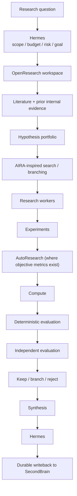

# Research Plane

**Status:** current canonical architecture and methodology document for
research workflows. **Last reconciled:** 2026-09-24.

This document does not redesign the Agent OS and does not introduce a
second orchestrator. It describes how the Research Plane referenced in
`docs/current-architecture.md` §15 works, using the loop/graph discipline
already defined in `docs/loop-graph-engineering.md`.

Preserved core facts, unchanged:

**Hermes** = global orchestrator / research director / resource manager.
**`~/agent-stack`** = policy, workflows, evals, and runtime definitions.
**`~/SecondBrain`** = durable validated research knowledge.

No new global agent framework, memory system, graph database, vector
database, or orchestration layer is introduced by this document.

---

## 1. Research Plane Identity

| Component | Role |
|---|---|
| **Hermes** | research director |
| **OpenResearch** | research workspace / project / run / lineage layer |
| **AIRA-inspired strategy layer** | hypothesis search / branching / prioritization / resource allocation |
| **AutoResearch** | tight metric-driven experimental loop |
| **Research workers** | Claude Code / Codex / Qwen / other specialists |
| **Evaluators** | deterministic metrics + held-out evaluation + independent judge |
| **Claude Science** | optional external specialist |
| **SecondBrain** | durable scientific/institutional memory |

None of these components is a second global orchestrator. Hermes remains
the single authority over goal, budget, safety, permissions, and resource
allocation for every research task, exactly as it is for coding and
operational tasks elsewhere in `docs/current-architecture.md`.

---

## 2. Top-Level Research Flow



Every stage after "Hermes: scope/budget/risk/goal" is subject to the same
loop/graph discipline as any other task (`docs/loop-graph-engineering.md`
§1): a single research question defaults to a single loop, and branches
into a graph only when justified (§17 below).

---

## 3. OpenResearch Role

Treat OpenResearch as:

- research workspace
- project state
- experiment/run organization
- artifact tracking
- experiment lineage
- worktree/branch isolation
- parallel research branches
- remote/local compute coordination

It should **not** become:

- a global router
- canonical memory
- policy authority
- final evaluator

**Status: high-priority research subsystem candidate — benchmark/
integration required.** No repository evidence shows OpenResearch deployed
today; it is not marked as such.

---

## 4. AIRA-Inspired Research Strategy

AIRA/AIRA-dojo is **not** a mandatory dependency. What is adopted is the
reusable set of research-strategy principles:

- maintain a portfolio of hypotheses
- branch exploration when useful
- prune weak branches
- prioritize promising branches
- allocate compute based on expected information gain / value
- reuse discoveries across workers
- avoid rediscovering known failed paths
- share intermediate findings
- separate search strategy from experiment execution

Supported strategy styles, conceptually: greedy, beam-like, evolutionary,
MCTS-like, successive halving, asynchronous portfolio search. **The
strategy chosen depends on the problem and budget — no single search
strategy is hardcoded globally.**

---

## 5. AIRA-Dojo Position

**Status: research-agent engineering / evaluation reference, framework
candidate — NOT a required core dependency.**

Reusable concepts recorded for future reference: task, solver, operator,
search policy, run, runner.

Used primarily as inspiration for: research-agent eval methodology,
search-policy experimentation, solver/operator decomposition, parallel
research evaluation.

Do not introduce it into runtime until a concrete capability gap appears.

---

## 6. AIRA2 Principles

**Status: architectural principles**, not a dependency. Captured lessons:

- avoid unnecessary synchronous experiment serialization
- support asynchronous worker pools when useful
- treat validation quality as a first-class problem
- prefer consistent/held-out evaluation
- allow multi-turn/ReAct-style research workers

**Faster exploration is useless if the evaluator is noisy or gameable.**
Evaluation quality must dominate raw experiment count — this is the
research-plane instance of `docs/loop-graph-engineering.md` §5's
"deterministic validation before probabilistic judgement."

---

## 7. AIRA3 Principles

**Status: architectural inspiration / knowledge-compounding pattern**, not
an installable dependency. Useful idea: multiple long-lived research
agents, shared findings, shared artifacts, knowledge compounding,
decentralized exploration.

Hermes stays above this layer:

```
Hermes
  → goal
  → budget
  → safety
  → permissions
  → resource allocation
```

Research workers may coordinate more loosely inside a research commons, but
they do not become independent system owners.

### Research Commons (conceptual)

Contains: working hypotheses, intermediate findings, temporary notes,
experiment artifacts, branch state, failed approaches, open questions.

**This is working research memory, not canonical durable memory** — see §8.

---

## 8. Working Memory vs. Durable Memory

| | Scope |
|---|---|
| **Research working memory** | OpenResearch / experiment tree / shared working state |
| **Durable knowledge** | SecondBrain |

Do not write every intermediate thought into SecondBrain.

### Promotion flow

```
temporary finding
  → validated evidence
  → provenance
  → dedupe
  → claim/decision/result
  → SecondBrain
```

This is the research-specific instance of the canonical write rule already
in `docs/current-architecture.md` §3 — SecondBrain's `wiki/` still requires
review before canonical mutation; OpenResearch's working state is the
research-plane equivalent of `inbox/` + evidence, not a second canonical
store.

Temporary speculation, failed scratch reasoning, noisy intermediate
observations, and duplicate findings remain in the research workspace
unless they become useful validated knowledge.

---

## 9. Karpathy-Style AutoResearch Loop

**Status: ADOPT METHODOLOGY / LOOP PATTERN.** AutoResearch is a bounded
objective-metric experiment loop — the research-plane specialization of
`docs/loop-graph-engineering.md` §15.

```
fixed evaluation harness
constrained editable surface
comparable resource/time budget
one or more objective metrics
modify → run → measure
keep improvement / revert regression
repeat
```

Suitable for: model architecture tuning, hyperparameter optimization,
reward shaping, routing thresholds, retrieval tuning, inference/runtime
tuning, compiler/kernel optimization, resource scheduling experiments.

**Not suitable when:** success cannot be meaningfully evaluated, metrics
are easily gamed, or qualitative scientific judgement dominates.

Candidate changes must not modify: held-out data, evaluator, promotion
threshold, security policy, permissions, budget accounting.

---

## 10. Research Worker Roles

Workers are defined by task, not rank. No single "best research worker" is
designated — selection is task- and evidence-driven, consistent with
`docs/current-architecture.md` §8 and `config/routing.yaml`'s reviewer rule.

| Worker | Role |
|---|---|
| **Claude Code** | difficult research code, architecture, scientific implementation review |
| **Codex** | experiment implementation, batch code changes, tests |
| **Qwen / local model** | routine research planning, local analysis, lightweight orchestration support |
| **Frontier model** | difficult hypothesis synthesis, ambiguous scientific reasoning |

**Status: Claude Code / Codex — CURRENT research execution workers** (they
are already CURRENT/CORE execution workers per
`docs/current-architecture.md` §8; this section states their research-task
application, not a new capability).

---

## 11. Compute Plane

Compute is replaceable infrastructure: MSI, SSH machines, a future RTX 3080
node, cloud GPU, Kaggle, other approved compute.

Hermes owns: budget, availability, resource conflicts, scheduling, GPU
profile switching, timeout, cancellation — the same MSI resource-profile
lifecycle already defined in `docs/current-architecture.md` §5.

OpenResearch/AutoResearch may **request** compute; they do not own global
resource policy.

**Status: MSI — CURRENT compute resource. Future RTX 3080 / cloud —
OPTIONAL/FUTURE compute**, unchanged from `docs/current-architecture.md` §5.

---

## 12. Evaluation

Layered evaluation:

1. deterministic metrics first
2. then held-out/consistent evaluation
3. then independent model/human judgement when needed

Avoid: researcher == sole evaluator; training metric == scientific truth;
validation metric == guaranteed generalization.

Prefer: held-out sets, hidden evaluation when possible, multiple seeds,
ablations, baseline comparison, confidence intervals/statistical tests when
appropriate, reproducibility, artifact-backed results.

**Evaluation must be protected from candidate mutation** — the research
instance of `docs/loop-graph-engineering.md` §6 (evaluator independence)
and §15/§17 (candidate must not modify its own evaluator).

---

## 13. Research-Specific Knowledge Model

SecondBrain remains canonical storage — unchanged from
`docs/current-architecture.md` §3 and `docs/loop-graph-engineering.md` §13.
Research outputs become graph-ready via typed relations, not a graph
database:

```
Paper       → supports    → Claim
Claim       → motivates   → Hypothesis
Hypothesis  → tested_by   → Experiment
Experiment  → used        → Dataset
Experiment  → produced    → Artifact
Experiment  → produced    → Result
Result      → supports / contradicts → Hypothesis
Decision    → selected    → Branch
Result      → learned_from → Lesson
```

Provenance fields to preserve where practical: `source`, `run_id`,
`commit`, `dataset`, `model`, `worker`, `metric`, `timestamp`, `artifact`,
`evaluator`.

**Do not add a graph database.**

---

## 14. Negative Results and Failed Branches

- a negative experiment is not useless
- a failed hypothesis is not deleted
- an invalid approach should remain discoverable
- a repeated known failure should be avoided

Record: what was tried, under what conditions, why it failed, evaluator
evidence, whether the failure generalizes.

Promote meaningful failed results into durable knowledge when they can
prevent future wasted work — this is a first-class SecondBrain writeback,
not a second-class record.

---

## 15. Novelty / Duplication Control

Before expensive research: check literature, check SecondBrain, check
prior experiments, check failed branches.

Avoid rediscovering: existing literature, already-rejected internal
hypotheses, duplicated experiment configurations, known implementation
failures.

Novelty checking reduces waste — it does not block legitimate replication.

---

## 16. Claude Science

**Status: OPTIONAL EXTERNAL SPECIALIST.** Potential use: deep scientific
synthesis, specialized scientific tool integrations, high-value paper
support, domains where its integrated environment adds value.

It is **not**: canonical memory, default research engine, global
orchestrator, mandatory dependency.

```
Hermes
  → selected research task
  → Claude Science
  → artifacts/evidence
  → verification
  → SecondBrain
```

Used only when expected value justifies the external dependency/cost.

---

## 17. Research Graph Engineering

Apply the existing loop/graph policy from
`docs/loop-graph-engineering.md` §1: default to one research loop. Create
graph structure only when:

- hypotheses can be explored independently
- different workers/tools are needed
- parallel experiments save meaningful time
- independent verification is valuable
- shared state/lineage is required

```
literature
   ↓
hypothesis generation
   ↓
┌──────┬──────┬──────┐
H1     H2     H3
│      │      │
E1     E2     E3
└──────┴──────┴──────┘
       ↓
   evaluator
       ↓
branch / keep / reject
```

**Do not create multi-agent graphs for simple literature summaries or
one-shot analysis** — that stays a single loop.

---

## 18. Research Telemetry

Fields: research question, hypothesis id, branch, worker, model, provider,
prompt/operator, search strategy, experiment id, commit, dataset, seed,
compute target, wall time, GPU time, cost, metric, baseline, evaluator,
result, keep/reject, failure class, artifacts, citations, lesson.

This extends the general telemetry schema in
`docs/current-architecture.md` §16 with research-specific fields. It
should support later analysis such as: which workers generate useful
hypotheses? which search policies waste compute? which evaluators
correlate with held-out success? which experiment types fail repeatedly?

Not implemented today — `state/` and `evals/` remain empty scaffolded
directories (confirmed 2026-09-24). This is the declared target schema, not
a claim of current instrumentation.

---

## 19. Meta-Research / Improving the Research System

Controlled improvement of research methodology follows the same
self-improvement pipeline as the rest of the system
(`docs/current-architecture.md` §17, `docs/loop-graph-engineering.md` §17):

```
research runs
  → telemetry
  → meta-analysis
  → improvement proposal
  → held-out research benchmark
  → independent judge
  → canary
  → promote or rollback
```

Possible improvement targets: hypothesis generation policy, search
strategy, worker selection, experiment prioritization, retrieval strategy,
evaluator selection, compute allocation.

**The candidate must not silently modify:** benchmark, held-out tasks,
judge, promotion criteria, safety policy, permissions.

---

## 20. Final Research Principles

- evidence before narrative
- hypothesis != result
- negative results are knowledge
- preserve lineage
- protect evaluation
- parallelize only independent work
- optimize information gain, not agent count
- working memory != durable memory
- research artifacts must be reproducible
- failed branches should remain queryable
- Hermes remains the global authority

---

## 21. Status Table

| Component | Status |
|---|---|
| Hermes | CURRENT / CORE research director |
| SecondBrain | CURRENT / CORE durable research memory |
| OpenResearch | RESEARCH SUBSYSTEM CANDIDATE |
| Karpathy AutoResearch | ADOPT METHODOLOGY / LOOP PATTERN |
| AIRA-dojo | REFERENCE / FRAMEWORK CANDIDATE |
| AIRA2 | ARCHITECTURAL PRINCIPLES |
| AIRA3 | ARCHITECTURAL INSPIRATION / KNOWLEDGE-COMPOUNDING PATTERN |
| Claude Science | OPTIONAL EXTERNAL SPECIALIST |
| Claude Code / Codex | CURRENT research execution workers |
| MSI | CURRENT compute resource |
| future RTX 3080 / cloud | OPTIONAL/FUTURE compute |

No candidate component listed above is installed or production-ready
unless repository evidence proves it. None does today.

---

## Appendix — Compatibility Review (2026-09-24)

A review of `docs/current-architecture.md`, `docs/loop-graph-engineering.md`,
`CLAUDE.md`, `config/*`, `workflows/`, `evals/`, and `state/` against this
document found **no architectural conflict** requiring a redesign.

**Checked, no violation found:**

- **Second research orchestrator** — none exists; OpenResearch/AIRA/
  AutoResearch/Claude Science are all explicitly non-orchestrator roles in
  this document and in `docs/current-architecture.md` §19's anti-duplication
  rules.
- **Duplicated memory systems** — no second canonical memory is proposed;
  §8 explicitly separates working memory (OpenResearch) from durable memory
  (SecondBrain), matching the existing Hermes-memory-disabled /
  SecondBrain-canonical decision in `CLAUDE.md`.
- **Research workers writing canonical knowledge directly** — prevented by
  the same `config/permissions.yaml` gate already in place (`wiki/`
  writable only by the reviewer role, requires_review: true); nothing in
  this document proposes a research-specific bypass.
- **Evaluator and candidate being the same mutable system** — §9, §12, §19
  all explicitly forbid a candidate from modifying its own evaluator/
  held-out data/promotion criteria, consistent with
  `docs/loop-graph-engineering.md` §15–17.
- **Every research task forced into multi-agent mode** — §17 explicitly
  defaults to one loop and requires justification for graph structure.
- **Negative results discarded** — §14 explicitly promotes meaningful
  failed results into durable knowledge.

**Real gaps found (documentation only, not fixed in this pass):**

- No unbounded-experiment-loop guard exists yet in config — same gap
  already noted in `docs/loop-graph-engineering.md`'s appendix
  (`config/routing.yaml`'s escalation section has no numeric retry/time/
  cost bound). AutoResearch loops inherit this same gap; not new, not
  fixed here.
- No lineage/telemetry implementation exists — §18's schema and
  `docs/current-architecture.md` §16 are both declared targets against
  empty `evals/`/`state/` directories. Already an acknowledged, honestly
  labeled gap, not newly introduced.
- The merged status-table row in `docs/current-architecture.md` §18
  ("OpenResearch / AIRA / AutoResearch — FUTURE subsystem") is a
  simplification this document refines into five distinct statuses
  (§21). This is a refinement, not a contradiction — the merged row is not
  wrong, just coarser. Left as-is per the instruction to change
  `docs/current-architecture.md` only enough to add the link.

No meaningful contradiction exists.
